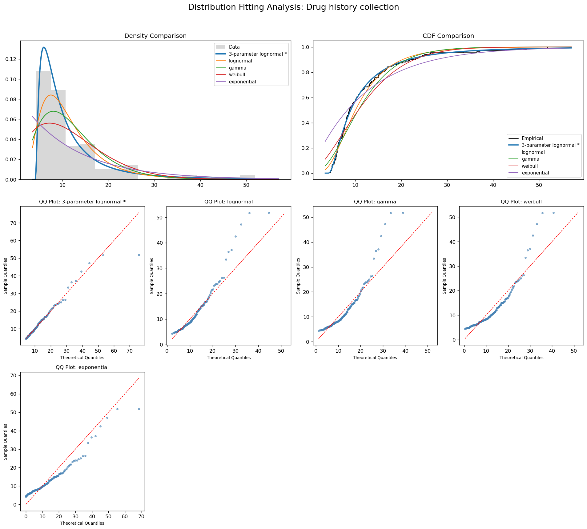

# Inpatient Pharmacy Discrete-Event Simulation

**Finding the bottlenecks in a hospital pharmacy and testing staffing and process changes, so that 95% of high-risk patients have their medicines reconciled within 24 hours**

MSc Business Analytics group project, Alliance Manchester Business School

`SIMUL8` · `Python` · `SciPy` · `Distribution fitting` · `Queueing` · `Scenario analysis`

---

## 📌 Business problem
A hospital's inpatient pharmacy handles about 36 admissions a day across six wards. Each high-risk patient goes through seven activities: drug history, medicines reconciliation, discrepancy resolution, prescription verification, discharge prescription writing, discharge verification and counselling. These are carried out by technicians, junior pharmacists and senior pharmacists, each **restricted to certain tasks**. Only 74% of patients currently have their medicines reconciled within 24 hours, against a target of nearly 100%.

## 🔧 Method
**1. Input modelling** (`distribution_fitting.ipynb`)
- Data audit: missing, non-positive and IQR outlier flags. Outliers were kept because they are realistic long tasks.
- Each activity was fitted with **Exponential, Gamma, Lognormal (2- and 3-parameter) and Weibull** distributions.
- Fits were selected with several criteria: **AIC, KS p-value, Anderson-Darling** and a custom **tail-error** metric at the 90th/95th/99th percentiles, because the long tails are what build queues.
- A **3-parameter lognormal** (fitted by custom maximum likelihood) was used where the data has a non-zero minimum. The fitted parameters were converted into SIMUL8 inputs (Lognormal + offset).

| Activity | n | Best fit | KS p | Tail error |
|---|---|---|---|---|
| Drug history | 152 | 3-param Lognormal | 0.99 | 0.06 |
| Medicines reconciliation | 101 | 3-param Lognormal | 0.26 | 0.23 |
| Prescription verification | 52 | Gamma | 0.24 | 0.09 |
| Discharge Rx writing | 30 | Weibull | 0.89 | 0.10 |
| Discharge Rx verification | 211 | Weibull | 0.83 | 0.06 |
| Patient counselling | 217 | Lognormal | 0.78 | 0.05 |



**2. Arrival modelling** (`arrival_modelling.ipynb`)
- Day-of-week demand coefficients (Thursday 1.22, Sunday 0.39) and in-hours vs out-of-hours split ratios were estimated from 3,360 admission records, at a mean of 36 admissions a day.
- An arrival schedule for SIMUL8 (100 trials × 8 weeks) was generated: arrivals per day and shift follow a Poisson distribution, with uniform timestamps within each window.
- Validation: the generated arrivals reproduce the empirical daily mean and every day-of-week coefficient and shift ratio to within about 0.01.

**3. Simulation model (SIMUL8)**
- Two pharmacy units, shared resource pools for each unit, a capability matrix for each staff grade, a Monday-to-Saturday schedule and a 13% rework loop for discharge prescriptions.
- **Three-layer validation:** face validity, white-box (transaction log) and black-box. In the black-box test, simulated service times were compared with the observed data using t-tests, and **all six activities passed** (p > 0.05).
- 30 trials × 8 weeks, with a 2-week warm-up.

## 📈 Key results
**Base case:** every member of staff runs at 90–100% utilisation. There are two structural bottlenecks:
- **Discharge prescription writing**: only senior pharmacists can do it (99% busy), and the mean wait is over 1,400 minutes.
- **Medicines reconciliation**: only 74% of patients are reconciled within 24 hours.

| Scenario | Reconciled within 24 h | Avg time in system |
|---|---|---|
| Baseline | 74.0% | 4,016 min |
| Task prioritisation | 58.1% (congestion moves upstream) | 2,305 min |
| Task specialisation | 1.4% (loses the pooling benefit) | 9,971 min |
| **Prioritisation + 1 technician** | **95.6%** | **757 min** |
| + reduced rework (13% → 8%) | 95.3% | 873 min |

**Recommendation:** combine **task prioritisation with one extra technician**, the cheapest grade. This meets the KPI and gives the lowest time in system, with the new post at a sustainable 87% utilisation. Process changes alone cannot fix structural understaffing, and restricting staff to narrow tasks makes performance much worse.

## 📁 Repository structure
```
├── distribution_fitting.ipynb   # data audit, distribution fitting, SIMUL8 parameter conversion (with outputs)
├── arrival_modelling.ipynb      # demand coefficients, Poisson arrival generator, validation (with outputs)
├── figures/
└── requirements.txt
```

## 📂 Data availability
The timing and admission data were provided for coursework and are **not included**. The SIMUL8 model file is not included because it needs licensed software to open.

## 👥 Team & my contribution
Group project. **My contribution:** [fill in, e.g. distribution fitting and input modelling]

---
**Author:** Yi-Wen (Sophia) Su · [LinkedIn](https://www.linkedin.com/in/your-handle)
